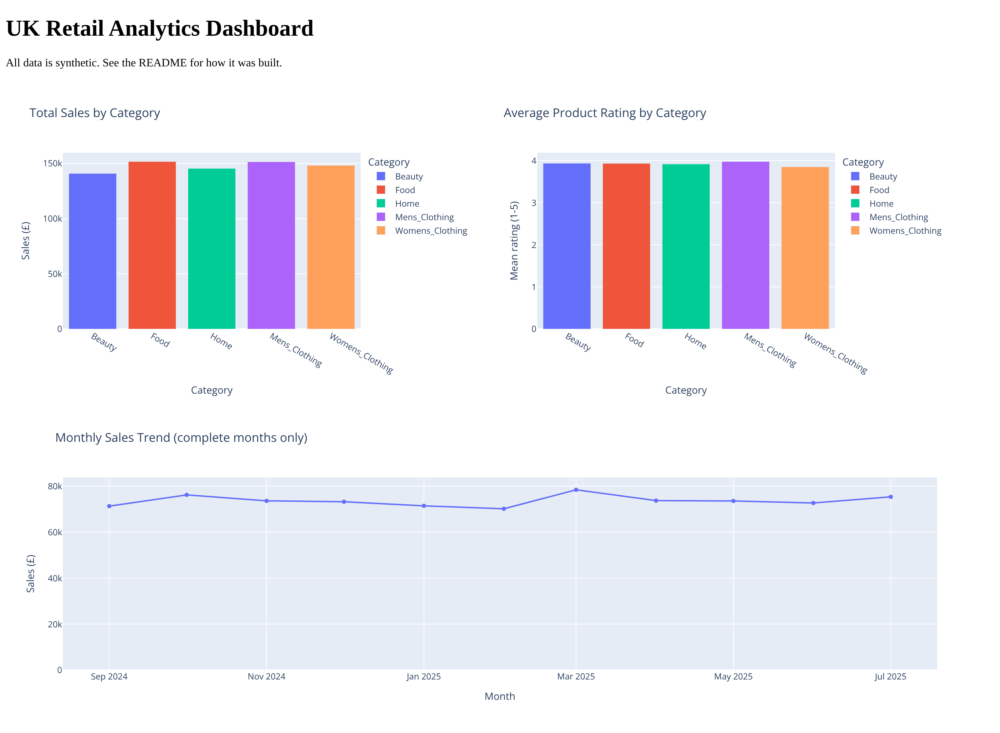

# UK Retail Analytics: Synthetic Dataset and Dashboard


[](LICENSE)

A synthetic, multi-table retail dataset modelled on the structure of a UK high-street retailer, with an interactive Plotly Dash dashboard built on top of it. I built it in August 2025 to practise relational data modelling and business-intelligence reporting without using confidential company data.

> **All data is synthetic.** No real customers, transactions or company records are included. Store names such as "M&S Store 0" are invented labels. This project is not affiliated with or endorsed by Marks and Spencer plc.



## Dataset

Nine CSV files in `data/`, linked by keys in a normalised relational schema:

| File | Rows | Contents |
| --- | ---: | --- |
| `products.csv` | 1,000 | SKU, name, category, subcategory, brand, price, cost, launch date, colour, sizes, material |
| `customers.csv` | 10,000 | Name, email, signup date, date of birth, gender, postcode area, loyalty tier |
| `stores.csv` | 25 | Store name, city and UK region |
| `transactions.csv` | 13,000 | Timestamp, customer, channel (9,811 in store, 3,189 online), store, payment type, totals |
| `transaction_line_items.csv` | 33,596 | Product, quantity, unit price, discount and line total for each order (1 to 10 items, mean 2.6) |
| `returns.csv` | 520 | Returned product, date, quantity and refund amount |
| `reviews.csv` | 2,688 | Product, customer, rating (1 to 5) and review text |
| `inventory_snapshots_30days.csv` | 30,000 | Daily stock, incoming and reserved quantities for 500 products in 25 stores, 10 July to 8 August 2025 |
| `summary_counts.csv` | 1 | Row count of each table |

Transactions cover one year, from 9 August 2024 to 7 August 2025, across five categories: Beauty, Food, Home, Men's Clothing and Women's Clothing.

```text
customers ──< transactions >── stores
                  │
                  └──< transaction_line_items >── products ──< reviews
                                                     │
                       returns >─────────────────────┤
                                                     │
                       inventory_snapshots >─────────┘ (and stores)
```

### Data integrity

Every product, transaction and store key resolves to a row in its parent table. Two kinds of missing key are deliberate:

- 3,189 online orders have no `store_id`.
- 49 orders have no `customer_id` (guest checkouts).
- 10 reviews have no `customer_id` (anonymous reviews).

## Dashboard

`dashboard/app.py` builds three views:

- total sales by product category
- average review rating by category
- monthly sales trend for complete months only (September 2024 to July 2025); the partial first and last months, which hold only a few days of data, are left out so they do not appear as false drops

### Run it

```bash
python -m venv .venv
source .venv/bin/activate        # Windows: .venv\Scripts\activate
python -m pip install -r requirements.txt
python dashboard/app.py
```

Then open http://127.0.0.1:8050.

## Example questions the data supports

- Sales and margin by store, region, channel and category
- Customer segmentation, such as RFM scoring by loyalty tier
- Market basket analysis on line items
- Return rates by product and category
- Stock levels against sales over the 30-day inventory window
- Linking review ratings to repeat purchases

## Limitations

- The script that generated the dataset is not included in this repository, so the data cannot be regenerated from source here.
- `transactions.is_return` is `False` for every order, even though `returns.csv` lists 520 returns. Use `returns.csv` as the source of truth for returns.
- The inventory snapshots cover 500 of the 1,000 products and the last 30 days only.
- Being synthetic, the data has no real seasonality or customer behaviour; patterns in it reflect the generator's rules.

## Repository structure

```text
uk-retail-analytics/
├── dashboard/
│   └── app.py
├── data/
│   └── *.csv
├── docs/
│   └── dashboard.png
├── LICENSE
├── requirements.txt
└── README.md
```

## Licence

Released under the [MIT Licence](LICENSE).

## Author

**Sohail Shaik**, MSc Bioinformatics (Distinction), University of West London. More at [sohail-shaik-bioinformatics.vercel.app](https://sohail-shaik-bioinformatics.vercel.app).
